# COMP472 Project Report — Team COMP472_Group10_F

| Name | Student ID |
|------|------------|
| Arthur Guerinault | 40374063 |
| Quentin Lapierre | 40374065 |
| Zarin Haque | 40317494 |

Code, figures and instructions to reproduce every number in this report: see the `README.md` of our repository.

---

## 1. Problem and data

We classify two Kaggle datasets of pre-extracted feature vectors. We only use the provided features and labels (no pretrained model, no external data).

| Dataset | Train rows | Test rows | Features | Classes | Chance level |
|---------|-----------:|----------:|---------:|--------:|-------------:|
| image | 20,000 (400 per class) | 5,000 | 500 | 50 | 2.0 % |
| sentiment | 12,000 (4,000 per class) | 5,000 | 768 | 3 (negative / neutral / positive) | 33.3 % |

What we observed in the data before choosing any model:

- **image**: all features are non-negative and every row has an L2 norm of 1, so the raw values are small (around 1/√500 ≈ 0.045). Feature spreads are very different: the largest standard deviation is about 13 times the smallest one (smallest std = 0.007).
- **sentiment**: BERT embeddings (mean pooling), not normalized (row norm ≈ 9), with a few dimensions that take large negative values. Feature spreads are much more similar (largest / smallest std ≈ 4).
- No missing values, and the classes are perfectly balanced in both training sets.

## 2. Validation methodology

- **Stratified 80/20 split** of the training data (`src/split.py`): for each class, 80 % of its examples go to the training part and 20 % to the validation part, so both parts keep the class balance. This gives 16,000 / 4,000 examples for image and 9,600 / 2,400 for sentiment.
- The split uses a fixed seed (42), so **every model is trained and evaluated on exactly the same split**.
- Every choice (hyperparameters, feature scaling, final model) is made on the validation accuracy. The Kaggle leaderboard was never used to choose a model.
- Scaling statistics (mean, std) are always computed on the training part only, to avoid data leakage.
- **Noise level**: with 2,400 to 4,000 validation examples, a difference of about ±1 point of accuracy can be noise. When two settings are within 1 point of each other, we consider them equivalent (grey band on the hyperparameter figures) and prefer the simpler or cheaper one.

### 2.1 Metrics

- **Accuracy** (`src/metrics.py`): the percentage of examples the model classifies correctly. It is our main metric because the Kaggle score is the average of the image accuracy and the sentiment accuracy [1]. It is also a fair measure here: every class has the same number of examples, so a model cannot get a high accuracy just by always predicting the same class.
- **Per-class accuracy and confusion matrices** (`src/metrics.py`): the accuracy of each class, and a table of which class is predicted for which true class. We use them in the error analysis (section 5) to see which classes fail and which classes get mixed up, for example the neutral texts.
- **Chance level**: the accuracy of random guessing, 1 / number of classes (2 % for image, 33.3 % for sentiment). It is shown in the data table (section 1) and the comparison table (section 4) to show how far above guessing each model is.
- **Out-of-bag accuracy** (Random Forest only, section 3.3): a second test score that the forest computes on the training rows each tree did not see.
- **Purity** (k-Means only, section 6): how well the clusters match the true classes.
- **How much a validation accuracy can vary**: with 2,400 to 4,000 validation examples, the standard error of an accuracy, √(p(1 − p) / n), is about 1 point (0.8 for image, 1.0 for sentiment). This confirms that the ±1 point noise level used above is a reasonable choice.

## 3. Models and hyperparameter selection

k-NN, Decision Tree, Random Forest and k-Means are implemented from scratch with NumPy. The neural network uses PyTorch. No machine-learning library (scikit-learn, etc.) is used.

### 3.1 k-Nearest Neighbours

**Implementation** (`src/models/knn.py`): squared Euclidean distance between each validation point and every training point, the `k` closest training points are kept, then either a **simple majority vote** or a **distance-weighted vote** (each neighbour votes with weight 1 / squared distance, so the closest neighbours count much more). Neighbours are computed once for the largest `k`, then every smaller `k` reuses the first columns.

**Experiments**: `k` ∈ {1, 3, 5, 11, 21, 31, 61, 101} × {raw, standardized (z-score) features} × {simple, weighted vote}.

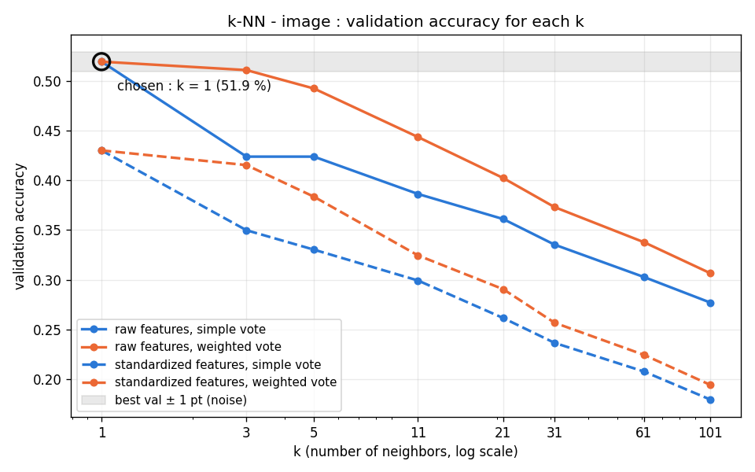
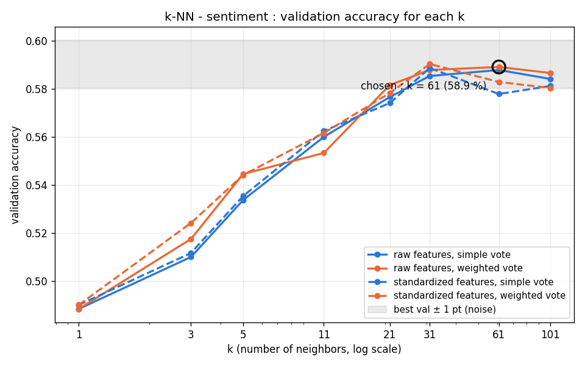

**Effect of `k`**:

- **image**: the best `k` is **1** (51.9 %), and accuracy decreases steadily as `k` grows (30.7 % at `k = 101`, weighted vote). Each class has only 320 training examples spread over 50 classes, and the classes form small, tight groups: the single closest neighbour is often of the right class, while more distant neighbours mostly belong to other classes.
- **sentiment**: the opposite. `k = 1` gives only 48.8 %, accuracy rises until `k ≈ 31` and stays on a plateau (58–59 %) up to `k = 101`. The three classes overlap a lot, so a single neighbour is unreliable (high variance); averaging many neighbours smooths the decision.
- This is the bias/variance trade-off: a small `k` follows every training point (low bias, high variance), a large `k` averages over a large region (high bias, low variance). The best value depends on how the classes are laid out in each feature space.

**Weighted vs simple vote**: on image, weighting helps a lot for small `k` (at `k = 3`: 51.1 % vs 42.4 %). With 50 classes, the 3 neighbours often belong to 3 different classes; the simple vote then breaks the tie arbitrarily, while the weighted vote follows the closest neighbour. On sentiment the difference is below 1 point (noise).

**Raw vs standardized features**: standardization **hurts image by about 9 points** (43.0 % vs 51.9 % at `k = 1`) and changes nothing on sentiment. On image, some features barely vary (std = 0.007); dividing by their std multiplies them by up to ~140, so these almost-constant (noisy) dimensions start to dominate the distance. Only 46 % of the validation points keep the same nearest neighbour after standardization. On sentiment, the stds are already similar, so standardization rescales all features by similar factors and the neighbours barely change (88 % keep the same nearest neighbour).

**Chosen**: image `k = 1`, weighted vote, raw features (51.9 %); sentiment `k = 61`, weighted vote, raw features (58.9 %).

### 3.2 Decision Tree

**Implementation** (`src/models/decision_tree.py`): binary tree built recursively. At each node we try every feature and, for each feature, up to 10 candidate thresholds (quantiles of its values), and keep the question `feature <= threshold` with the lowest weighted **Gini impurity** of the two children. A node becomes a leaf (majority class) when it is pure, when it has fewer than `min_samples_split = 2` examples, or when it reaches `max_depth`.

**Experiment**: train and validation accuracy for each `max_depth`.

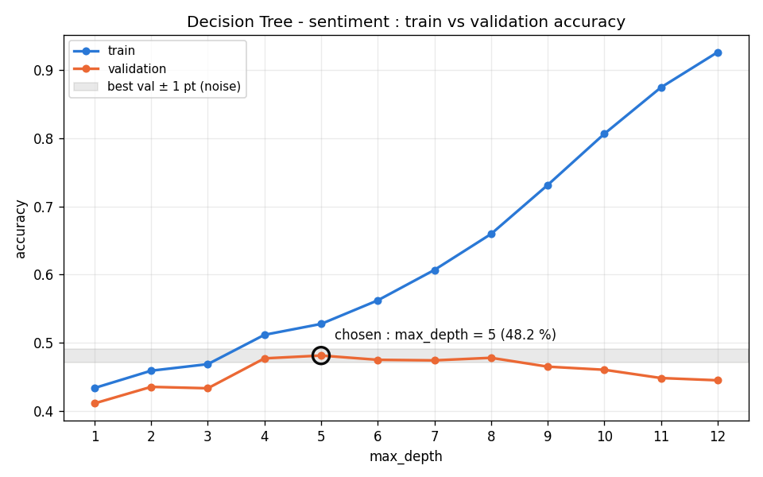
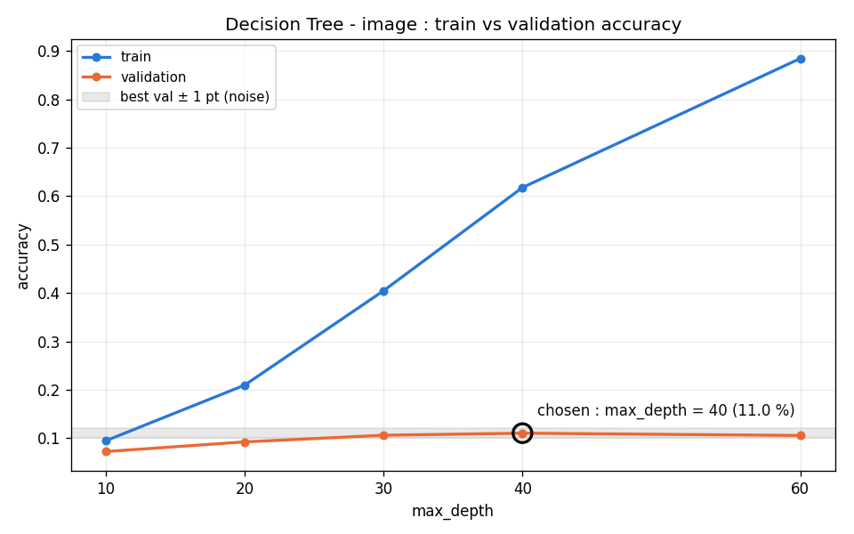

- **sentiment**: training accuracy keeps rising with depth (43 % at depth 1, 93 % at depth 12), but validation accuracy peaks at **depth 5 (48.2 %)** and then slowly decreases (44.5 % at depth 12). Below depth 4 the tree **underfits** (train and validation both low); beyond depth 5 it **overfits** (the gap between train and validation grows to almost 50 points).
- **image**: the tree never generalizes well. Training accuracy goes from 10 % (depth 10) to 88 % (depth 60), while validation accuracy stays between 7 % and 11 %. Best: **depth 40 (11.0 %)**. With 50 classes, the tree needs many levels just to separate them, and each deep leaf ends up with very few examples: it memorizes the training set instead of learning general rules.
- Why the tree is weak here: every split looks at **one feature at a time** (axis-aligned cuts), while in these embeddings the information is spread over hundreds of features at once. A single feature is rarely enough to separate the classes.

**Chosen**: image `max_depth = 40`, sentiment `max_depth = 5`.

### 3.3 Random Forest

**Implementation** (`src/models/random_forest.py`, built on our Decision Tree from section 3.2, following [2] and Lab 5 [3]). A Random Forest is many Decision Trees that vote. Two kinds of randomness make the trees different from each other:

- **Random rows (bootstrap)**: each tree is trained on a random sample of the training rows, drawn with replacement (some rows are picked several times, others not at all). Each tree sees about 63 % of the rows; the other ~37 % are its **out-of-bag** rows.
- **Random features**: at each split, a tree only looks at a random subset of the features, √(number of features) by default (22 of 500 for image, 27 of 768 for sentiment). We added this as an optional `n_features` setting to our Decision Tree; when it is not set, the tree is unchanged.
- **Prediction**: the trees vote and the most common answer wins (ties go to the smallest class number).
- **Out-of-bag accuracy**: each training row is predicted only by the trees that did not train on it. This gives a free extra test score without using the validation set.
- **Tests** (`tests/check_forest.py`) check, for example, that a 1-tree forest with no randomness equals our Decision Tree, and that the same seed always gives the same forest.

**Experiments** (`experiments/run_forest.py`):

1. **Number of trees**: we trained one forest (300 trees for image, 100 for sentiment) and scored it using only its first `n` trees, for each `n`. Since each tree is built independently, the first 10 trees of a 300-tree forest are exactly a 10-tree forest.
2. **`max_depth`** and **`n_features`**: one 30-tree forest for each value tested, with the other settings at their default.

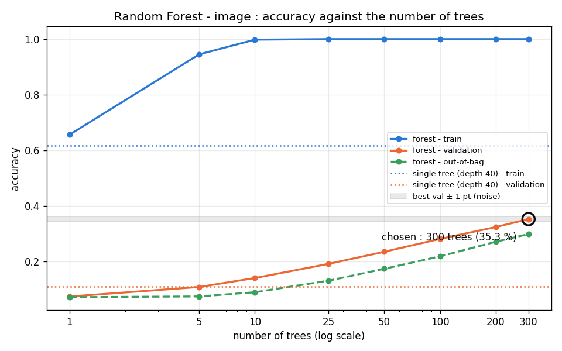
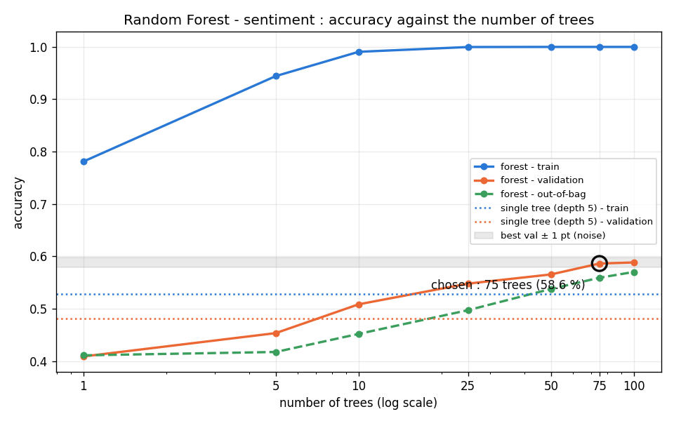
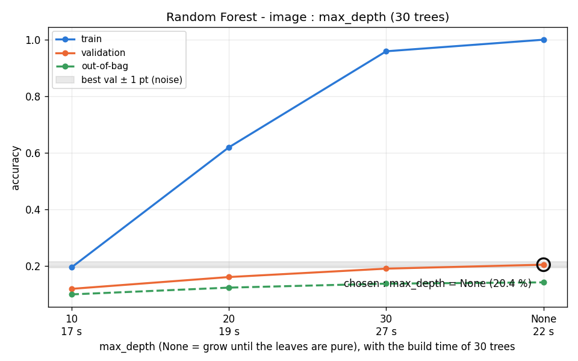
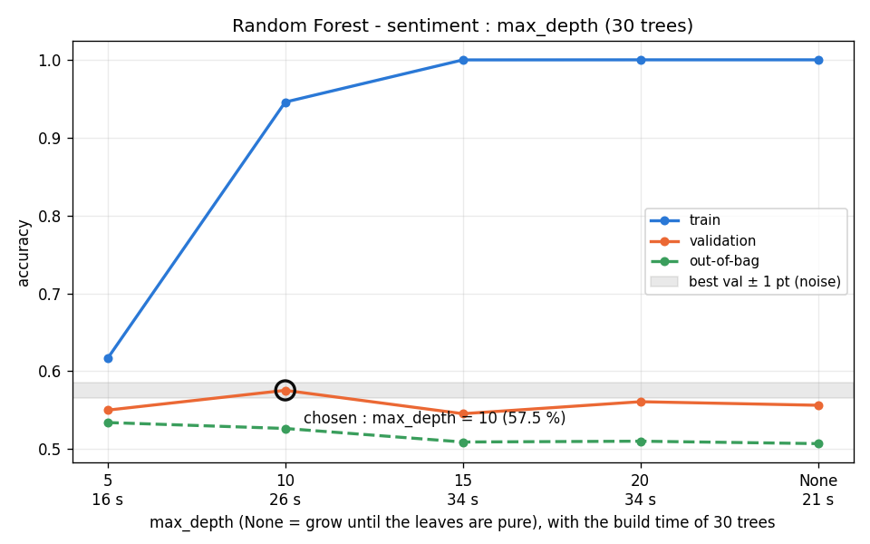
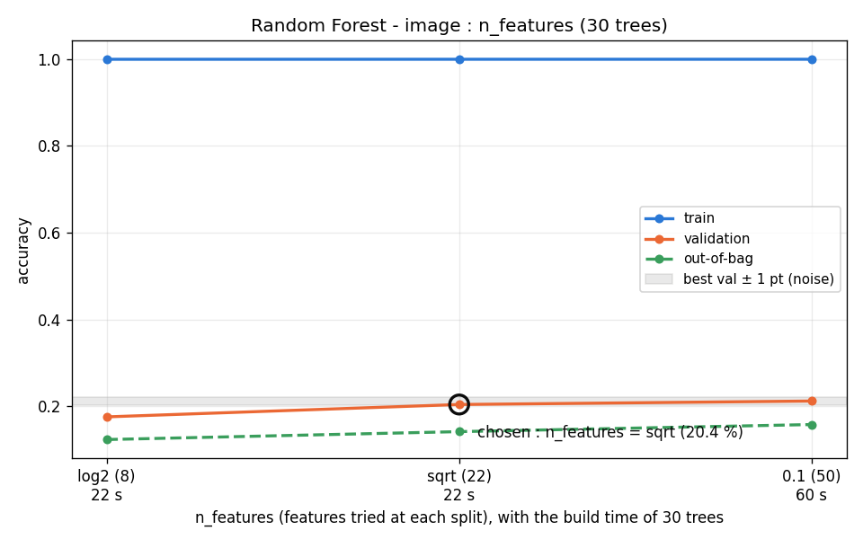
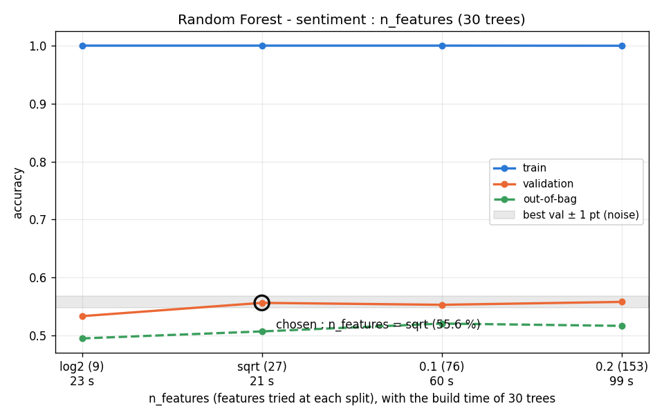

- **Number of trees**: one tree alone is weaker than our tuned Decision Tree (image 7.4 % vs 11.0 %, sentiment 40.9 % vs 48.2 %). Adding trees steadily improves validation accuracy: image 14.1 % (10 trees) → 28.2 % (100) → **35.3 % (300)**, still rising; sentiment 50.8 % (10) → 58.6 % (75) → **58.8 % (100)**, where it reaches a plateau. The OOB accuracy rises the same way but stays lower (image: 29.9 % vs 35.3 % at 300 trees): each row is only voted on by the ~37 % of trees that did not see it, so it measures a smaller forest.
- **Random Forest vs single Decision Tree**: the forest generalizes much better than our best single tree: **image 11.0 % → 35.3 %, sentiment 48.2 % → 58.8 %**. Each full-depth tree overfits its own bootstrap sample, but the trees see different rows and different features, so their errors are partly independent and the vote cancels many of them out: averaging reduces the variance, which is exactly what made the single tree overfit.
- **`max_depth`** (30 trees): on image, deeper is better (unlimited depth is best, 20.4 %). On sentiment, depth 10 was best (57.5 %, vs 55.6 % for unlimited depth), but the other depths show no clear trend (54.5–56.1 %).
- **`n_features`**: on image, 10 % of the features (21.2 %) is within noise of `sqrt` (20.4 %) and 2.7 times slower to train; `log2` is worse (17.5 %). On sentiment, `sqrt`, 10 % and 20 % are within noise; `log2` is worse. We kept `sqrt`, the usual default.

**Chosen**: image 300 trees, `max_depth = None`, `n_features = sqrt`. Sentiment: the figures circle 75 trees and `max_depth = 10`, the simplest settings within noise of the best. For the comparison (section 4) we kept the 100-tree, full-depth forest of the number-of-trees experiment: 75 and 100 trees are within noise, and depth 10 was only tested with 30 trees (section 8).

### 3.4 Neural Network (MLP)

**Implementation** (`src/models/neural_network.py`, PyTorch): fully connected network `Linear → ReLU → Dropout` for each hidden layer, then a `Linear` output layer (50 or 3 outputs). Trained with Adam, cross-entropy loss and mini-batches of 128, reshuffled at every epoch. Each run lasts 30 epochs (60 for the wide image networks); after each epoch we measure the validation accuracy and keep the weights of the best epoch (early stopping). The seed is reset at the start of every run, so all experiments start from the same initial weights and compare only the setting that changes.

**Feature scaling**: sentiment is standardized (z-score). Image is multiplied by a constant √500: its rows have norm 1, so the raw values are around 1/√500; multiplying every value by the same constant brings them around 1 (better for gradient descent) without changing the shape of the data.

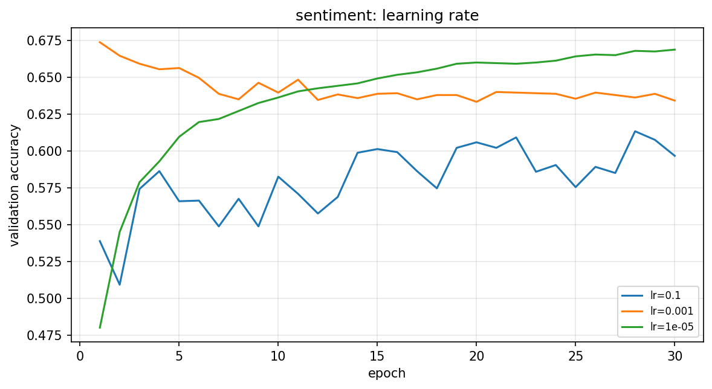
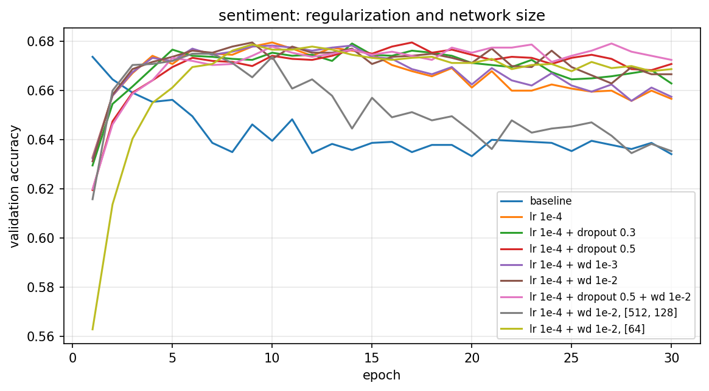
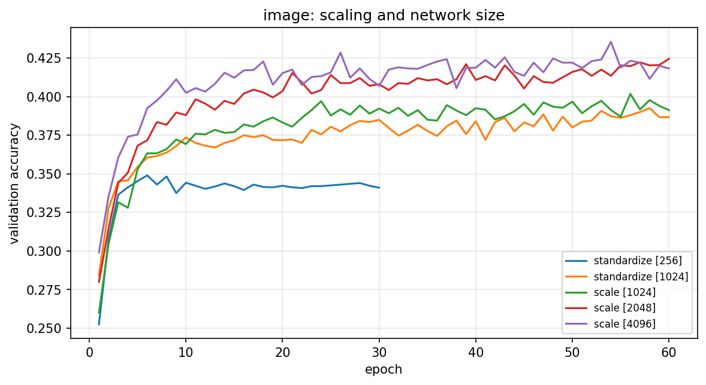

- **Learning rate (sentiment)**: `lr = 0.1` is too large, the validation accuracy jumps around (51–61 %). `lr = 1e-3` reaches its best value (67.4 %) after the first epoch, then overfits: training accuracy reaches 100 % at epoch 13 while validation accuracy drops to ~63.5 %. With ~197,000 weights for 9,600 training examples, the network has enough capacity to memorize the training set. `lr = 1e-5` is too slow (still climbing after 30 epochs: underfitting). `lr = 1e-4` (second figure) gives the best curves (~68 % around epoch 10).
- **Regularization (sentiment)**: with `lr = 1e-4`, weight decay and dropout slow down the decrease after the peak, but the best accuracies are all around 68 % (within noise). A deeper network `[512, 128]` overfits faster (back to ~63.5 % at epoch 30); a smaller one `[64]` learns more slowly without being better.
- **Image**: with standardized features, the best is ~35 % with `[256]` and ~39 % with `[1024]`. With the same `[1024]` network, constant scaling and standardization are within noise (40.2 % vs 39.3 %). Unlike k-NN, the network can learn to give the almost-constant features small weights, so standardization does not hurt it much; we kept constant scaling since standardization brings no gain and clearly hurt k-NN (section 3.1). Wider networks help more: ~42.5 % with `[2048]`, ~43.5 % with `[4096]`. Unlike sentiment, image needs more capacity (50 classes to separate), and the stronger dropout compensates for the faster overfitting.

**Chosen**: sentiment `[256]`, no dropout, `lr = 1e-4`, `weight_decay = 1e-2`, standardized features (68.0 %); image `[4096]`, dropout 0.6, `lr = 1e-3`, `weight_decay = 1e-3`, scaled features (43.6 %).

## 4. Comparison of the four classifiers (validation accuracy)

All models trained on the same 80 % training part, evaluated on the same 20 % validation part (`python -m experiments.compare_models`, `results/compare_models.csv`).

| Model | image (50 classes) | sentiment (3 classes) |
|-------|-------------------:|----------------------:|
| k-NN | **51.9 %** | 58.9 % |
| Decision Tree | 11.0 % | 48.2 % |
| Random Forest | 35.3 % | 58.8 % |
| MLP | 43.6 % | **68.0 %** |
| *chance* | *2.0 %* | *33.3 %* |

- **The best algorithm is not the same on the two datasets.** k-NN wins on image, the MLP wins on sentiment.
- **image → k-NN**: the image classes form small, tight groups in feature space (best `k` = 1). k-NN uses this directly, with no training. The MLP has to learn 50 classes from only 320 examples each, with a large network (~2.3 M parameters): it does not reach the k-NN level.
- **sentiment → MLP**: the three classes overlap in the raw feature space (k-NN needs ~60 neighbours to average out the noise, and k-Means cannot separate them, section 6). The MLP learns a combination of all 768 features that separates them better, about 9 points above k-NN, mostly thanks to the neutral class (section 5.1).
- **Decision Tree**: the weakest on both datasets: one-feature-at-a-time splits are poorly suited to dense embeddings, and it overfits quickly.
- **Random Forest**: far better than a single tree thanks to averaging, equal to k-NN on sentiment, but still below k-NN and the MLP on image.
- **A more complex model is not always better**: the simplest model (k-NN, no training) is the best on image.

## 5. Error analysis

Produced by `python -m experiments.analyze_errors` on the validation set. Figures: `figures/confusion_*.png`.

### 5.1 Sentiment: is the neutral class harder?

Per-class accuracy (recall) on the validation set:

| Model | negative | neutral | positive | overall |
|-------|---------:|--------:|---------:|--------:|
| k-NN (`k = 61`) | 77.4 % | **31.0 %** | 68.4 % | 58.9 % |
| Decision Tree (depth 5) | 56.4 % | **36.1 %** | 52.0 % | 48.2 % |
| Random Forest (100 trees) | 69.5 % | **47.6 %** | 59.4 % | 58.8 % |
| MLP (`[256]`, `lr = 1e-4`) | 77.4 % | **56.0 %** | 70.5 % | 68.0 % |

- **Yes, neutral is clearly the hardest class for every model.** For k-NN, neutral examples are misclassified almost equally as negative (282) and positive (270) out of 800. Neutral lies "between" the two other classes in the embedding space, so its neighbours are often negative or positive examples.
- Negative and positive are also confused with each other (174 positive → negative, 112 negative → positive for k-NN). One likely reason: mean-pooled BERT embeddings capture what a text is about at least as much as its polarity, so two texts on the same topic with opposite sentiments can be close neighbours.
- **Different models make different mistakes**: among the three simpler models, k-NN is the best on negative and positive but the worst on neutral; the Random Forest has a more balanced profile and is better on the difficult neutral class (47.6 %), for the same overall accuracy as k-NN.
- **The MLP corrects most of the neutral mistakes**: 56.0 % on neutral, 25 points above k-NN and 8 above the Random Forest, while matching k-NN on negative and beating it on positive. Most of its 9-point advantage over k-NN comes from this class. It also mixes up the two opposite sentiments much less (88 positive → negative and 54 negative → positive, vs 174 and 112 for k-NN). Neutral remains its hardest class, confused about equally with negative (171) and positive (181).

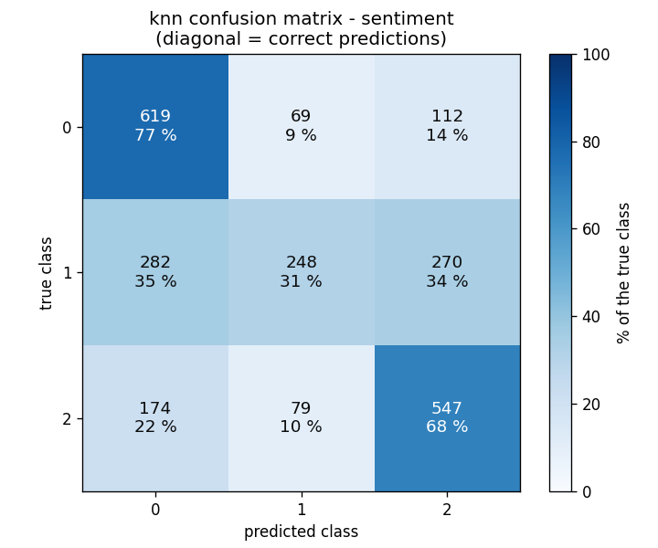
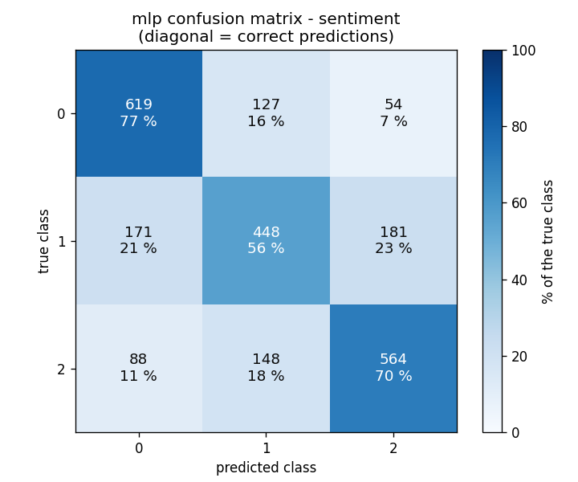

### 5.2 Image: which classes are confused?

- **Same easy and hard classes across models.** Classes 5, 13, 46 and 48 are among the 5 best classes for both k-NN (70–78 %) and the Random Forest (69–74 %). Classes 22 and 29 are among the 5 worst for both (k-NN ~35 %).
- **Same confusions across models.** The most frequent k-NN confusions (3 → 2, 27 → 25, 37 → 39, 10 → 12, 14 → 12) are also among the most frequent Random Forest confusions. The MLP's most frequent confusions include three of them as well (3 → 2, 27 → 25, 37 → 39). Three very different algorithms making the same mistakes suggests that these classes are genuinely close in the feature space (probably visually similar objects), rather than a weakness of one model. The labels are integers only, so we cannot name the objects.
- **Decision Tree failure mode**: many different classes are predicted as class 34 (40, 42, 31, 0, 37 → 34). A few large leaves that the tree could not split further absorb examples of many classes.

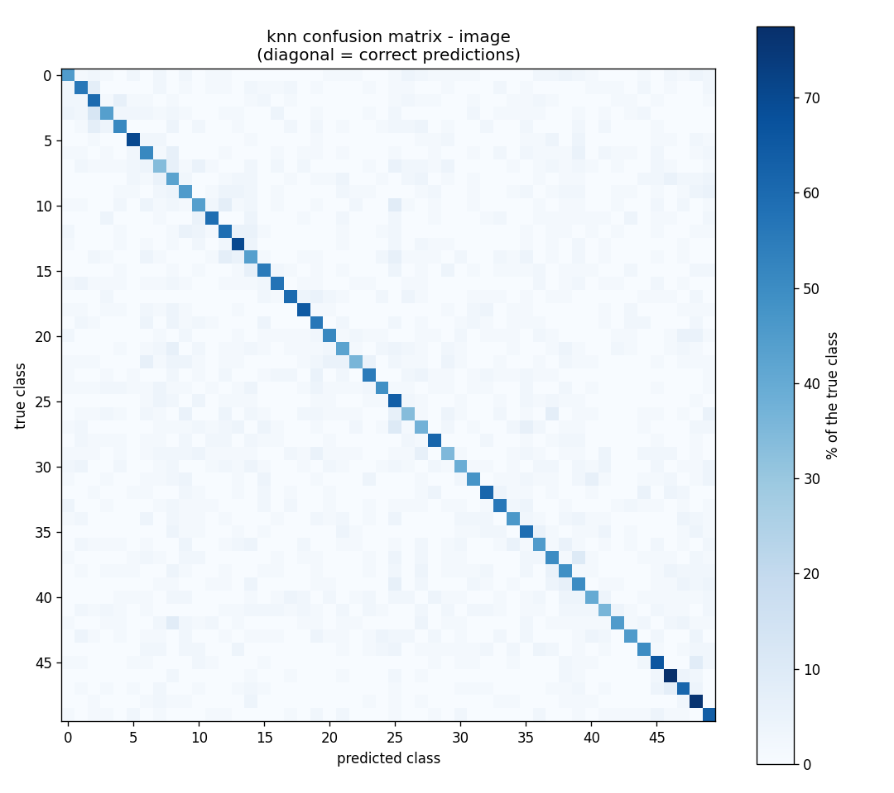

## 6. Clustering experiment (k-Means)

**Goal**: check whether the feature vectors naturally group by class, without using the labels.

**Implementation** (`src/models/kmeans.py`): `k` random training points as initial centroids; then repeat (1) assign each point to its closest centroid (squared Euclidean distance) and (2) move each centroid to the mean of its points, until no point changes cluster. A cluster that becomes empty keeps its previous centroid.

**Protocol** (`python -m experiments.run_kmeans`): whole training set, `k` = number of classes (3 and 50), raw and standardized features. The labels are only used afterwards, to measure the **purity**: each cluster is given its majority class, and purity is the fraction of points that belong to the majority class of their cluster (1 = every cluster contains a single class; for random clusters, purity ≈ chance level).

| Dataset | Raw | Standardized | Random clusters |
|---------|----:|-------------:|----------------:|
| sentiment (`k = 3`) | 0.389 | 0.401 | 0.333 |
| image (`k = 50`) | 0.100 | 0.104 | 0.020 |

**Sentiment: the three sentiments do not separate naturally.** Purity is barely above chance, and each cluster contains a large share of all three classes (raw features, rows = clusters):

| Cluster | negative | neutral | positive |
|---------|---------:|--------:|---------:|
| 0 | 1,200 | 1,466 | 1,702 |
| 1 | 1,428 | 1,502 | 840 |
| 2 | 1,372 | 1,032 | 1,458 |

The main directions of variation in the BERT embeddings are not sentiment (probably topic or style). This agrees with the supervised results: models that use the raw geometry (k-NN, k-Means) struggle on sentiment, while the MLP, which learns a new combination of features, does much better.

**Image: some classes form clean clusters, most do not.** Purity is 5 times the chance level but still low. A few clusters are almost pure: one cluster of 106 images is 99 % class 5, others are 59 % class 13 and 51 % class 48; but the least pure clusters are large (500–860 images) and mix many classes (under 5 % for their main class). **The purest clusters correspond to classes 5, 13, 46 and 48: exactly the classes that k-NN and the Random Forest classify best (section 5.2).** The easy classes are the ones that form compact, isolated groups in feature space.

**Standardization** changes the purity by less than 1 point. On image, it produces some very small clusters (down to 2 points), built around outliers.

## 7. Final model and Kaggle submission

`python -m make_submission`: for each dataset, we compare the validation accuracy of the chosen k-NN and the chosen MLP, keep the better one, **retrain it on the full training set** (train + validation), and predict the test set.

| Dataset | k-NN (val) | MLP (val) | Submitted |
|---------|-----------:|----------:|-----------|
| image | 51.9 % | 43.6 % | k-NN (`k = 1`, weighted, raw features) |
| sentiment | 58.9 % | 68.0 % | MLP, retrained for 9 epochs (best validation epoch) |

Expected score from validation: (51.9 + 68.0) / 2 ≈ **59.9 %**. Kaggle score: public **60.1 %** (close to the 59.9 % expected from validation), private is revealed after the competition closes.

## 8. Limitations and what we would improve with more time

- **k-NN**: only the Euclidean distance was tested. Cosine distance would be a natural choice for embeddings (on image it is equivalent, since all rows have norm 1, but not on sentiment).
- **Decision Tree**: only `max_depth` was tuned; `min_samples_split`, a minimum leaf size and the splitting criterion were not. Only 10 candidate thresholds are tried per feature.
- **Random Forest**: `max_depth = 10` was better on sentiment with 30 trees; we did not test it with 100 trees. On image, accuracy was still rising at 300 trees.
- **MLP**: on image, the dropout (0.5 → 0.6) was changed together with the network size, so its own effect was not measured. Each setting was run with a single seed; several seeds would show how much of the small differences (often under 1 point) is due to chance.
- **k-Means**: one random initialization only, and only `k` = number of classes; testing several `k` and several initializations would give a more complete picture.
- **Ensembles**: combining k-NN and the MLP (for example, averaging their votes) could exploit their different mistakes.

## 9. Team contributions

| Member | Contributions |
|--------|---------------|
| Arthur Guerinault | Data pipeline: loading (`src/data.py`), stratified split (`src/split.py`), metrics (`src/metrics.py`), standardization (`src/preprocessing.py`). k-NN: implementation (`src/models/knn.py`), experiments on `k`, raw vs standardized features and simple vs weighted vote (`experiments/run_knn.py`). Decision Tree: implementation (`src/models/decision_tree.py`) and `max_depth` experiment. Kaggle submission (`make_submission.py`). With Claude (see Appendix): hyperparameter figures, k-NN and Decision Tree error analysis, 4×2 comparison table, k-Means experiment, repository structure, README and report drafts |
| Quentin Lapierre | Neural network: implementation (`src/models/neural_network.py`), experiments and figures (`experiments/run_nn.py`, `figures/nn_*.png`), MLP in the error analysis (`experiments/analyze_errors.py`) |
| Zarin Haque | Random Forest: implementation (`src/models/random_forest.py`, `n_features` option of the Decision Tree), tests (`tests/check_forest.py`), experiments and figures (`experiments/run_forest.py`), Random Forest in the error analysis (`experiments/analyze_errors.py`) |

## References

[1] e3ham, "COMP472 Project - Fall 2026 (LIVE)," Kaggle, 2026. [Online]. Available: https://www.kaggle.com/competitions/comp-472-project-fall-2026-concordia

[2] L. Breiman, "Random forests," *Machine Learning*, vol. 45, no. 1, pp. 5–32, 2001.

[3] "COMP 472 Lab 5: Decision Trees and Random Forests," Concordia University, Montreal, QC, Canada, Fall 2026.

## Appendix: use of AI tools

**Team statement.** We used Claude (Anthropic) to explain the algorithms and how to implement them in Python, to review and debug our code, and to help us interpret our results. In addition, at our request, Claude wrote:

- the k-Means implementation (`src/models/kmeans.py`, `experiments/run_kmeans.py`, `tests/check_kmeans.py`), see exchange A7;
- the first draft of the `README.md`, see exchange A8;
- the first draft of this report, see exchange A9;
- some helper scripts (tests, plotting, error analysis and comparison scripts), listed in Arthur's section below.

We read and checked these files, and had Claude explain the k-Means code to us line by line. Zarin Haque rewrote the Random Forest section of the report.

Below, each member gives their most representative exchanges, with the exact prompt and the model's response. Follow-up messages in the same conversation (small fixes, re-runs, "it works now") are not reproduced. Arthur's conversations were in French: the prompts are given verbatim with an English translation, and the responses are verbatim excerpts ("[...]" marks omitted parts).

### Zarin Haque

**Model:** Claude (Anthropic)

I asked Claude for help troubleshooting issues I had (mostly in regards to speeding up the process and errors I had).

#### Exchange 1:

**Prompt**

> I'm working on the Random Forest part of my COMP 472 project. I built it on top of our own decision tree. Each tree is trained on its own bootstrap sample, so the trees don't depend on each other. The image dataset has 16,000 training rows and 500 features, and training 300 full-depth trees one after another takes a very long time. I've uploaded random_forest.py and decision_tree.py. is there a way to train several trees at the same time like with processes? (using only the python standard library and numpy)

**Response**

Since the trees are independent, this parallelizes easily. Each worker builds one tree, and you collect the results.

**Use processes, not threads.** Most of `build_tree` is Python code: recursion, loops over features and thresholds, small NumPy calls. Python's Global Interpreter Lock lets only one thread run Python code at a time, so threads would give almost no speed-up. Processes each have their own interpreter and really do run in parallel. `concurrent.futures.ProcessPoolExecutor` is the simplest tool for this.

**Send the data only once.** Every argument passed to a worker is pickled and copied into the worker process. If each job carried `X` (16,000 × 500 float32 ≈ 32 MB), you would copy 32 MB × 300 jobs. Instead, use the pool's `initializer`. It runs once when each worker starts, so it can store `X` and `y` in module-level globals. After that, each job only needs a seed and the hyperparameters.

**Make the worker function module-level.** The pool sends the function to the workers by pickling a reference to it (module name + function name). Lambdas and functions nested inside other functions can't be pickled that way, so the worker must be a plain top-level function.

```python
from concurrent.futures import ProcessPoolExecutor

_X, _y = None, None          # set once in every worker process

def _init_worker(X, y):
    global _X, _y
    _X, _y = X, y

def _build_in_worker(job):    # top level, so it can be pickled
    seed, params = job
    return build_one_tree(_X, _y, seed=seed, **params)

pool = ProcessPoolExecutor(max_workers=n_jobs, initializer=_init_worker, initargs=(X, y))
outputs = pool.map(_build_in_worker, jobs)   # results come back in the order of jobs
...
pool.shutdown()
```

Other suggestions:
- `pool.map` returns results in the order of the jobs, not the order they finish, so tree *t* is always at position *t*.
- Default to `os.cpu_count() - 1` workers so the machine stays usable.
- Keep an `n_jobs == 1` path that calls the same function in a normal `map`. It's easier to debug, and you can test that both paths give the same forest.

#### Exchange 2:
**Prompt**

> I added a ProcessPoolExecutor to train the trees in parallel. I run the experiments with "python -m experiments.run_forest". Now the experiments seem to start again inside the worker processes and i get this error: "RuntimeError: An attempt has been made to start a new process before the current process has finished its bootstrapping phase." 
> I've uploaded run_forest.py and random_forest.py. Please help me understand what's causing this and how to fix it

**Response**

On macOS (since Python 3.8) and on Windows, `multiprocessing` starts workers with the **spawn** method. Each worker is a brand-new Python interpreter, and to find the functions it must run, it **imports your main script**. Any code at the top level of that script runs again inside every worker. In your case that means the experiment calls, which build a forest, which tries to start a new pool from inside a worker that is still starting up. That's the error.

The fix is the standard guard. Put everything that should only run in the main process under:

```python
if __name__ == "__main__":
    os.makedirs("figures", exist_ok=True)
    os.makedirs("results", exist_ok=True)
    names = sys.argv[1:] or ["sentiment", "image"]
    for name in names:
        run_forest(name)
```

When a worker imports the main module, Python names it `__mp_main__`, not `__main__`, so the guarded block is skipped. Function definitions and imports stay at the top level, because the workers need them.

Linux uses **fork** by default, so the script may work there without the guard. Still add it, since your teammates and the TA may run the code on Windows or macOS. Every script that ends up calling `build_forest` (for example `analyze_errors.py` and `compare_models.py`) needs the guard too.

#### Exchange 3:
**Prompt**

> The forest trains in parallel now, but the script sometimes crashes after the figures are made. The error is "RuntimeError: main thread is not in main loop", and sometimes "Tcl_AsyncDelete: async handler deleted by the wrong thread". I only save the figures with plt.savefig and plt.close (never open a window). please help me figure out if the problem comes from my forest code and how to fix it

**Response**

The forest is fine. The error comes from Matplotlib's **backend**, the part that draws figures. On your setup Matplotlib picked **TkAgg**, an interactive backend that creates Tkinter (Tcl/Tk) objects for each figure even if you never show it. Tk isn't thread-safe: its objects must be created and destroyed in the thread that owns the Tk interpreter (the main thread).

`ProcessPoolExecutor` runs a background thread in your main process to send jobs and collect results. Python's garbage collector can run in whichever thread happens to be active, so if it cleans up a leftover Tk object while that background thread is running, Tk complains. That's why the message mentions threads and nothing about forests, and why it only appeared once the pool was added.

You only save PNG files, so you don't need a GUI backend. Switch to **Agg**, which renders straight to image files and never touches Tk:

```python
import matplotlib
matplotlib.use("Agg")  # Save figures to files without opening a window
import matplotlib.pyplot as plt  # noqa: E402
```

`matplotlib.use` has to be called before `pyplot` is imported (directly or by another module), which is why the import comes after it. The `# noqa: E402` comment tells linters that the late import is intentional. You could also set the environment variable `MPLBACKEND=Agg`, but putting it in the script means the TA doesn't need to know about it.

#### Exchange 4:
**Prompt**

> Our project has to be reproducible, so we use a fixed seed (SEED = 42). Before, I created one "np.random.default_rng(SEED)" and passed it to every tree. Since I added the process pool, the results change depending on the number of workers, and sometimes some trees are identical. I want the forest to be exactly the same no matter how many processes I use. I also want tree number t to always be the same tree, whatever the total number of trees. I've uploaded random_forest.py, help me seed the trees correctly

**Response**

A `Generator` can't be shared across processes. When it's sent to a worker it is pickled, which **copies its state**. Every worker then starts from the same state and draws the same numbers, so you get duplicate trees. Even when it doesn't duplicate, which tree gets which random numbers depends on scheduling, so results depend on `n_jobs`.

The fix is to give **each tree its own seed**, decided before any work is shared out. NumPy has a tool for this: `np.random.SeedSequence`. Its `spawn(n)` method creates `n` child seeds that are statistically independent of each other, and child number *i* depends only on the parent seed and on *i*. It doesn't depend on `n`. So:

- the seeds don't depend on which process builds which tree, so the forest is the same for any `n_jobs`;
- the first 5 seeds of `spawn(20)` equal the 5 seeds of `spawn(5)`, so the first 5 trees of a 20-tree forest **are** the 5-tree forest.

```python
tree_seeds = np.random.SeedSequence(seed).spawn(n_trees)    # one seed per tree
jobs = [(tree_seed, {"n_classes": n_classes, **params}) for tree_seed in tree_seeds]

def build_one_tree(X, y, n_classes, seed, ...):
    rng = np.random.default_rng(seed)        # this tree's own generator
    X_boot, y_boot, oob_idx = bootstrap_sample(X, y, rng, max_samples)
    tree = build_tree(X_boot, y_boot, n_classes, ..., n_features=n_features, rng=rng)
    return tree, oob_idx
```

The same `rng` is used for the bootstrap and for the feature subsets at every split, so the whole tree is set by its seed. `SeedSequence` objects can be pickled, so they can go in the jobs.

Seeds like `SEED + t` would mostly work too, but `spawn` is what NumPy's documentation recommends for parallel streams, and it makes the independence guarantee explicit. I'd also add tests: the same seed gives the same forest, `n_jobs=2` gives the same votes as `n_jobs=1`, and the 5-tree forest matches the first 5 trees of the 20-tree forest.

#### Exchange 5:
**Prompt**

> I wrote a test to check my forest: with n_trees = 1, bootstrap = False and n_features = None (all features), the forest should be exactly the same as our decision tree with the same depth but the test fails, the accuracy is almost the same and the root split is the same, but it's some deeper nodes use different features. I've uploaded random_forest.py, decision_tree.py and check_forest.py. help find where the difference comes from

**Response**

The difference most likely comes from **ties** in `best_split`, combined with the **order** in which features are tried.

`best_split` keeps a new split only if `score < best_score`, with a strict `<`. When two features give exactly the same Gini score, the one tried **first** wins. In the plain Decision Tree, features are tried in order `0, 1, 2, …`. In your forest code, "all features" is probably still drawn through the random subset, something like `rng.choice(n_feats, size=n_feats, replace=False)`. That returns every feature, but **shuffled**, so a different feature can win a tie.

Ties are common in deep nodes. A node with 2 rows of different classes can be split perfectly (score 0) by almost any feature where the two values differ. Each tree picks a different one of these equally good splits, and the trees diverge from there. That fits what you see: same root, nearly the same accuracy, different deeper nodes.

Fix: when the forest uses all the features, **don't draw any random features at all**. Pass `n_features=None` so `build_tree` uses `range(d)` in order, exactly as the plain tree does:

```python
k = get_k(n_features, n_feats)
params = {..., "n_features": None if k == n_feats else k,  # All features = normal tree, no random features
          ...}
```

This also means the "all features" forest no longer uses up random numbers on a pointless shuffle. Keep your sanity check as a permanent test:

```python
forest_1 = build_forest(X, y, 2, n_trees=1, max_depth=6, n_features=None, bootstrap=False, n_jobs=1, verbose=False)
assert forest_1["trees"][0] == tree, "1 tree, no bootstrap, all features should be the Decision Tree"
```

#### Exchange 6:
**Prompt**

> For the report, I need a plot of the accuracy against the number of trees, right now I have to train a new forest for each value in [1, 5, 10, 25, 50, 100, 200, 300] and on the image dataset that's 691 trees in total, and most of the work is repeated. I've uploaded run_forest.py and random_forest.py. How to get the whole curve without retraining a forest for every value

**Response**

Yes. Thanks to the per-tree seeds, tree *t* doesn't depend on the total number of trees, so **the first *n* trees of the 300-tree forest are exactly an *n*-tree forest**. Train one forest of 300 trees and score its prefixes. That's 300 trees instead of 691, with identical results.

You can do the scoring cheaply too. Get every tree's predictions once, as an array of shape `(n_trees, n_rows)`. Then add the votes one tree at a time and record the accuracy each time the count reaches a value in `ns`:

```python
def score_curve(all_votes, y, ns, n_classes):
    n_rows = all_votes.shape[1]
    counts = np.zeros((n_rows, n_classes), dtype=int)
    scores = []
    for t, votes in enumerate(all_votes, start=1):
        counts[np.arange(n_rows), votes] += 1
        if t in ns:
            scores.append(np.mean(np.argmax(counts, axis=1) == y))
    return scores
```

`np.argmax` returns the first maximum, so ties go to the smallest class, the same as `majority_vote`.

The out-of-bag curve works the same way: each tree only adds votes for its own OOB rows. One catch: with few trees, many rows have no OOB vote yet. A row is OOB for a given tree with probability about 1/e ≈ 0.37, so after *n* trees about 0.63ⁿ of the rows still have no vote. That's 63% at 1 tree, about 10% at 5, and about 1% at 10. Only score rows that have at least one vote, and report the **coverage** next to the score so the early points aren't misread.

The same trick works for your sweeps. The default-settings forest of 30 trees is just `first_trees(big_forest, 30)`, so it doesn't need retraining.

One caveat for the report: the points on this curve share trees, so they aren't independent experiments. The curve is smoother than separately trained forests would give, but it answers the question you're asking: what happens as you keep adding trees.

#### Exchange 7:

**Prompt**

> prediction is slow as our decision tree's predict function loops over the rows and calls predict_one recursively for each one. I don't want to change the tree format because the decision tree part is shared with my teammates, if i want to make it so a tree predicts many rows at once, do i send down all of the rows together

**Response**

Yes. Instead of sending **one row** down the whole tree, send **all the rows** down together. At each question node, one vectorized comparison splits the current rows into "go left" and "go right". At a leaf, every row that reached it gets the leaf's class in one assignment.

```python
def predict_tree(tree, X):
    y_pred = np.empty(len(X), dtype=int)

    def send_down(node, rows):
        if len(rows) == 0:            # no rows reach this node
            return
        if node["leaf"]:
            y_pred[rows] = node["class"]
            return
        go_left = X[rows, node["feature"]] <= node["threshold"]
        send_down(node["left"], rows[go_left])
        send_down(node["right"], rows[~go_left])

    send_down(tree, np.arange(len(X)))
    return y_pred
```

The number of Python function calls is now at most the number of nodes in the tree, not rows × depth, and the per-row work is done by NumPy. The rule is the same as in `predict_one` (`<=` goes left), so the predictions are identical. The tree dict format doesn't change, so it works for single Decision Trees too. The nested function is fine here because it's never pickled.

Add a test that it matches the original:

```python
assert np.array_equal(predict_tree(tree, X), decision_tree.predict(tree, X))
```

Then build the forest functions on top of it: `get_all_votes` stacks `predict_tree` over the trees, `majority_vote` counts the votes, and `score_curve` and the OOB curve reuse the same vote array.

### Arthur Guerinault

**Model:** Claude (Anthropic), used through Claude Code.

I asked Claude to act as a tutor: explain each algorithm on a small hand-worked example, give me function signatures to fill in, review my code and point to bugs without fixing them, and ask me TA-style questions. With this guidance I wrote the data loading, the stratified split, the metrics, the preprocessing, k-NN and the Decision Tree. At my request, Claude also wrote some helper code: several test scripts (`tests/check_metrics.py`, `tests/check_knn.py`, `tests/check_pipeline.py`), the scripts `experiments/run_tree.py`, `experiments/analyze_errors.py`, `experiments/plot_hyperparams.py` and `experiments/compare_models.py`, and the restructuring of the repository. It also wrote the k-Means, the README draft and the report draft (A7 to A9).

#### Exchange A1: setting up the tutoring

**Prompt** (excerpt of the first message)

> Je veux écrire tout le code moi-même : ton rôle est de me guider, pas de le faire à ma place. [...] N'écris et ne modifie aucun fichier du projet, sauf si je te le demande explicitement. Ne me donne pas d'implémentation complète d'un algorithme. Tu peux me donner du pseudo-code, des signatures de fonctions à remplir, et de courts extraits (quelques lignes) qui montrent une technique NumPy ou PyTorch sur un exemple jouet. Quand je bloque, donne d'abord un indice. [...] Avance une étape à la fois. Avant que je code, explique-moi l'algorithme étape par étape sur un petit exemple chiffré fait à la main, puis dis-moi quelles fonctions écrire et ce que chacune reçoit et renvoie. [...] À la fin de chaque étape, pose-moi 2 ou 3 questions comme le ferait un TA.

*Translation: "I want to write all the code myself: your role is to guide me, not to do it for me. [...] Do not write or modify any project file unless I explicitly ask. Do not give me a complete implementation of an algorithm; you may give pseudo-code, function signatures to fill in, and short snippets on a toy example. When I am stuck, give a hint first. [...] One step at a time: before I code, explain the algorithm on a small hand-worked example, then tell me which functions to write and what each one takes and returns. [...] At the end of each step, ask me 2 or 3 questions like a TA would."*

**Response** (excerpt)

> ## Feuille de route
> L'ordre suit les dépendances : tout ce qui est en haut est réutilisé par ce qui est en bas. [...]
>
> | # | Étape | Ce qu'elle produit | Comment vérifier |
> |---|---|---|---|
> | 1 | **Chargement** | `load(name)` → `X_train, y_train, X_test, ids_test` en NumPy `float32` | Shapes (20000×500, 12000×768), 400 / 4000 exemples par classe, aucun NaN |
> | 2 | **Split stratifié + metrics** | `stratified_split`, `accuracy`, `confusion_matrix`, `per_class_accuracy` [...] | Proportions des classes identiques dans train et val, aucune intersection, union = tout le dataset [...] |
> | 3 | **k-NN** | Distances vectorisées, normalization *fit sur le train seulement*, vote majoritaire et vote pondéré, balayage de k | k=1 prédit sur le train lui-même → 100 % [...] |
>
> [...]
>
> ## Pour l'étape 1
> Écris une fonction de ce genre :
> `def load_dataset(name: str, data_dir: str = "dataset"):` [...]

#### Exchange A2: learning the Decision Tree

**Prompt**

> on peut passer au decision tree, je ne connais pas l'algo il va falloir que tu m'expliques

*Translation: "we can move on to the decision tree, I don't know the algorithm, you'll have to explain it to me"*

**Response** (excerpt)

> Un Decision Tree classe un point en lui posant des questions du type **« feature_j ≤ seuil ? »**. [...]
> Le **Gini impurity** mesure à quel point un groupe mélange les classes : `Gini = 1 − Σ p_c²` [...]
> **Question « f0 ≤ 2.5 ? »** gauche (oui) : A, B → classes [0, 0] → Gini = 0 ; droite (non) : C, D, E, F → classes [1, 0, 1, 1] → Gini = 0.375 ; score = 2/6 × 0 + 4/6 × 0.375 = 0.25 [...]
> ### À toi : la question « f1 ≤ 4.5 ? »
> Calcule son score, avec la même méthode qu'au-dessus [...]
> ## Première étape du code : `src/models/decision_tree.py`
> `def gini(y, n_classes)` [...] `def split_score(y_left, y_right, n_classes)` [...]
> Indice pour `gini` : tu connais déjà la fonction qui compte les classes. Comment passer des comptes aux proportions ?

#### Exchange A3: checking my idea for the Gini function

**Prompt**

> Pour gini je peux faire un bincount et apres divisier chaque membre de l'array par le nombre de y de base, ca va me donner 0.5, 0,5 et faire 1 - (0.25 + 0.25) = 0.5 avec le premier exemple que tu m'as donnée ?

*Translation: "For gini, can I do a bincount, then divide each element of the array by the number of y, which gives 0.5, 0.5, and compute 1 - (0.25 + 0.25) = 0.5 with the first example you gave me?"*

**Response** (excerpt)

> Oui, c'est exactement ça [...]
> - **Pas de boucle pour les carrés.** Sur un array, `p ** 2` met chaque élément au carré d'un coup, et `.sum()` les additionne. [...]
> - **`minlength=n_classes`** dans le bincount, comme dans ton `vote`. [...]
> Un cas limite à garder en tête : si `y` est **vide**, `len(y) = 0` et tu divises par zéro. [...]
> Écris `gini` et `split_score`, puis vérifie avec les 5 valeurs attendues.

#### Exchange A4: k-NN weighted vote

**Prompt**

> le plus haut qu'on atteint c'est avec k=61/66
> on peut pas faire un dictionnaire qui ajoute la distance en plus de la positions ? par exemple avoir [[1, 0.90], ...]
> Je me rappelle plus, plus la distance est proche plus c'est proche de 0 ? Si c'est ca, il faut faire un check avant et dire que si la distance est egale a 0 alors on prend celui la car c'est exactement le meme

*Translation: "the best we get is with k=61/66. Can't we use a dictionary that stores the distance together with the position, e.g. [[1, 0.90], ...]? I don't remember: the closer the point, the closer the distance is to 0? If so, we need a check: if the distance is 0, we take that neighbour because it is exactly the same point."*

**Response** (excerpt)

> ## Mettre la distance avec la position : bonne idée, mais pas dans le même tableau
> Si tu mélanges positions et distances dans un même array NumPy, **tout devient float** [...]
> La solution la plus simple : `find_neighbors` renvoie **deux arrays de même shape** `(m, k_max)` [...]
> ## Distance 0
> Oui : **plus la distance est petite, plus le point est proche**. [...] Tu as deux options :
> - **Ta solution :** si un voisin est à distance 0, on prend directement sa classe. [...]
> - **Plus simple :** ajouter un tout petit nombre au dénominateur, `1 / (d + 1e-8)`. [...]
> Les deux sont valables. Choisis celle que tu sauras le mieux expliquer.

#### Exchange A5: interpreting the effect of standardization on k-NN

**Prompt**

> Sur sentiment, la normalization ne change presque rien parce que les écart-types des features sont faibles, donc ca ne bouge pas trop.
> Sur image, la normalization fait baisser l'accuracy parce que les features qui varient peu sont ___, et en les divisant par leur petit écart-type on ___. L'hypothèse de la normalization, c'est que ___, mais ici ___. Je ne sais pas quoi répondre je ne comprends pas trop [...]

*Translation: "On sentiment, normalization changes almost nothing because the feature standard deviations are small, so it doesn't move much. On image, normalization lowers the accuracy because the features that barely vary are ___, and by dividing them by their small std we ___. [...] I don't know what to answer, I don't really understand [...]"*

**Response** (excerpt)

> Pour ta phrase sur sentiment, un seul mot est faux : les écarts-types ne sont pas **faibles**, ils sont **proches les uns des autres**. Ils sont même plus grands que sur image (le plus petit vaut 0.146 sur sentiment, contre 0.007 sur image). Ce qui compte, c'est que le plus grand fait seulement 4× le plus petit. Toutes les features sont donc multipliées par des facteurs voisins, et les distances gardent les mêmes proportions. [...]

#### Exchange A6: why is the Decision Tree weaker than k-NN?

**Prompt**

> Est-ce que Decision Tree est forcement moins bien que kNN, ou est-ce que c'est qu'on l'a mal implementé donc il ne marche pas tres bien, ou que dans notre cas precis il n'est pas très performant

*Translation: "Is the Decision Tree necessarily worse than kNN, or did we implement it badly, or is it just not very good in our specific case?"*

**Response** (excerpt)

> Bonne question, et la réponse est la troisième option : **dans notre cas précis, il n'est pas très performant.** [...]
> - **Le seul raccourci qu'on a pris, ce sont les 10 seuils par feature.** Je viens de le tester : sentiment depth 5, n_thresholds = 10 : val 48.2 % (5 s) ; n_thresholds = 50 : val 48.0 % (20 s) [...]
> Dans ce genre de vecteur, **une dimension seule ne veut presque rien dire**. Le sens « positif / négatif » est réparti sur des **combinaisons** de centaines de dimensions. Or un arbre ne peut couper que **le long d'un axe** [...]

#### Exchange A7: the k-Means (written by Claude)

**Prompt**

> Putain je savais pas ! J'avais pas compris, tu peux faire le k-Means et tout m'expliquer stp, la structure doit ressembler a mon code, pas plus, je te laisse faire

*Translation: "I didn't know! I hadn't understood. Can you do the k-Means and explain everything to me please, the structure must look like my code, nothing more, I'll let you do it"*

**Response** (excerpt)

> J'ai écrit le k-Means et je l'ai commité sur `restructure-repo` [...]. `tests.check_kmeans` passe, et l'expérience complète tourne en 20 secondes. [...]
> ```
> src/models/kmeans.py       l'algorithme, comme knn.py
> experiments/run_kmeans.py  l'expérience, comme run_knn.py
> tests/check_kmeans.py      le test sur un exemple jouet, comme check_knn.py
> ```
> [...] | `fit(X, k)` | boucle assign → update jusqu'à ce que **plus aucun point ne change de cluster** | trouve `{1,2,3}` et `{10,11,12}`, inertie = 4 | [...]
> - **On réutilise `distances_to_one` de ton kNN.** [...]
> - **Un cluster vide garde son ancien centre.** Sans ça, `points.mean()` sur 0 point donnerait `NaN`. [...]
> ## ⚠️ Intégrité académique
> J'ai écrit ce code et le README à ta demande. Les consignes exigent de mettre **le prompt exact et la réponse** dans l'annexe LLM du rapport. Tu dois aussi pouvoir expliquer chaque ligne [...]

#### Exchange A8: the README draft (written by Claude)

**Prompt**

> Ok alors on va faire le README et apres tu me poseras autant de questions que tu veux faut qu'on se depeche, on verra un exam pour les questions comme ca je sais exactement ce qu'il se passe dans le code j'avoue que j'ai un peu tout zappé sur les fonctions hors de l'algo, dans le README nous on est le groupe 10_F, rajoute un champ "Name" "Student ID" je vais les remplir a la main, fais moi un premier jet

*Translation: "OK, let's do the README, and afterwards you can ask me as many questions as you want, we need to hurry; we'll do an exam so that I know exactly what happens in the code, I admit I forgot the functions outside the algorithms. In the README we are group 10_F, add a "Name" / "Student ID" field that I will fill in by hand. Write me a first draft."*

**Response** (excerpt)

> J'ai écrit un premier jet de `README.md` à la racine [...]. Il est en anglais et **pas encore commité**, pour que tu puisses le relire d'abord.
> - **Équipe** : COMP472_Group10_F, avec un tableau Name / Student ID [...]
> - **Repository layout** : l'arborescence, puis un tableau par dossier [...]
> - **Setup** : venv, `pip install`, téléchargement des CSV dans `dataset/` [...]
> Tout est tiré du code. [...]

#### Exchange A9: the report draft (written by Claude)

**Prompt**

> Ok alors ca me va alors on attaque le rapport, on va le faire en markdown pour l'instant et je le mettrai dans notion pour le rendre en PDF

*Translation: "OK, that works for me, let's start the report; we'll write it in Markdown for now and I'll put it in Notion to export it as a PDF"*

**Response** (excerpt)

> J'ai écrit le brouillon complet dans report.md, à la racine du repo. [...] Tous les chiffres viennent des CSV, des figures et des scripts que j'ai relancés aujourd'hui. [...]
> **Avant de rendre :**
> - **Relis tout.** Les interprétations sont de moi, et le TA va te questionner sur ce qui est écrit. Si une phrase ne te ressemble pas ou si tu ne saurais pas l'expliquer, on la reformule. [...]

### Quentin Lapierre

**Model:** Claude (Anthropic), used through Claude Code in my terminal.

I had programming experience (C, C++, TypeScript) but had barely used Python and had never trained a neural network, so I used Claude as a tutor for the MLP part. What it did, precisely:

- **Explanations**: it explained the concepts (standard deviation, standardization, train/validation split, training loop, learning rate, overfitting, dropout, weight decay), with diagrams, and quizzed me after each step; it corrected my answers.
- **Exploration notebook** (not submitted): Claude also helped me with a step-by-step notebook that I ran and studied (data preparation, model, training loop, experiments, error analysis).
- **`src/models/neural_network.py`**: written by me, function by function. Claude gave the specification of each function and reviewed my code; it found two bugs (`append` instead of `+=` when building the layers, and a `train_final` that wrongly picked the best epoch on the training accuracy).

I ran every experiment myself and checked that the scripts reproduce the reported numbers. My prompts were in French; they are translated below.

#### Exchange 1:

**Prompt**

> I have programming basics (C/C++/TypeScript) but I have barely touched Python and never touched neural networks. I will need help for this project.

**Response**

Claude proposed to build the code together, step by step, so that I could explain every line during the presentation, and reminded me that AI assistance must be acknowledged in the report. It explained a neural network in programmer's terms (a function made of matrix multiplications whose weights are adjusted to reduce a loss), set up a Python 3.12 environment with the versions of `requirements.txt`, and reused the team's `load_dataset`, `stratified_split` and `standardize` so that the MLP is validated on exactly the same split as the other models. Each step of the notebook ended with exercises.

#### Exchange 2:

**Prompt**

> I don't fully understand how the model is trained. Validation, standardization and standard deviation are still unclear to me. Can you explain with a diagram?

**Response**

Claude explained the standard deviation with two sets of grades with the same mean, standardization as putting every feature on the same scale (`z = (x − mean) / std`, computed on the training part only to avoid data leakage), and the train / validation / test split as "the course, the mock exam and the final exam". It drew the training loop as four steps repeated on each batch (predict, measure the error with the loss, compute the gradients with `backward`, update the weights with the optimizer), and showed how to read the training and validation curves to recognize overfitting and underfitting.

#### Exchange 3:

**Prompt**

> ### Question (by Claude)
> Which sentiment class is the most difficult? Which other classes is it often confused with, and why does that make sense?
> 
> ### Answer (by me)
> The most difficult class is “neutral.” It is often confused with the other two classes (positive and negative), and that’s normal. “Neutral” lies between the other two, so the sentiment becomes more mixed.

**Response**

Claude confirmed my answer and pointed to the confusion matrix: "neutral" is confused with both other classes (171 neutral reviews predicted negative and 181 predicted positive), while "negative" and "positive" are rarely confused with each other (54 and 88). It suggested one more sentence for the presentation: a neutral or mixed review often contains a bit of both sentiments ("the movie was okay, nothing more"), so the boundary is blurry on both sides. It also linked this to how the features are built: a sentence vector is the mean of its BERT token vectors, so "this movie is great" and "this movie is not great" differ by one word out of six and get very close vectors. Similar vectors can therefore have opposite sentiments, which is why the network, which can learn that a few small directions (like negation) matter, beats k-NN on this task.

#### Exchange 4:

**Prompt**

> ### Question (by Claude)
> Train the network with `lr = 1e-1`, `1e-3` and `1e-5` and compare the curves.
>
> ### Answer (by me)
> Here are the 3 plots. We can see that the smaller the step, the more accurate the model. And we can really see the difference with `1e-5`, which shows that the model follows the training curve quite well.

**Response**

Claude said that my observations were right but that the conclusion needed nuance: a smaller step does not automatically give a more accurate model, the best setting lies between the two extremes. It compared the best validation accuracy of each run. With `1e-1` (about 61%), the curves zigzag and the validation loss explodes, because the steps are so large that the model jumps over the good weights. With `1e-3` (about 67%), the model learns very fast, reaches its best score at epoch 1 and then overfits. With `1e-5` (also about 67%), the two curves stay close, so the model generalizes well, but it is slow and still improving at epoch 30, which is closer to underfitting. Since both `1e-3` and `1e-5` cap at about 67%, it explained that changing the step size alone would not go further and that the next step was to limit memorization with dropout and weight decay.

#### Exchange 5:

**Prompt**

> ### Question (by Claude)
> On the image task, the same `[1024]` network gets 39.3% with standardized features and 40.2% with raw features. Why can standardization hurt here?
>
> ### Answer (by me)
> Because standardization tends to give too much importance to "noise" (insignificant features).

**Response**

Claude said the answer was correct and suggested adding the mechanism to make it complete: standardization divides each column by its standard deviation, so a column that is almost always 0 has a tiny standard deviation, and its rare non-zero values get inflated (a 0.01 divided by 0.002 becomes 5). It connected this to the data: the image features are non-negative, 85% zeros, and each row already has length 1. The k-NN of my teammates shows the same effect more strongly (52% raw against 43% standardized).
